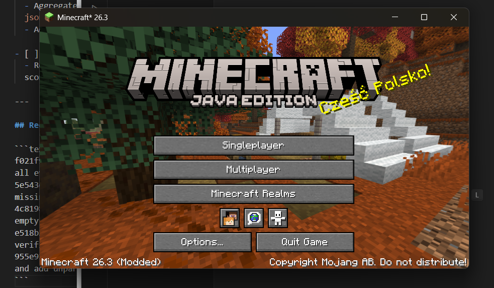
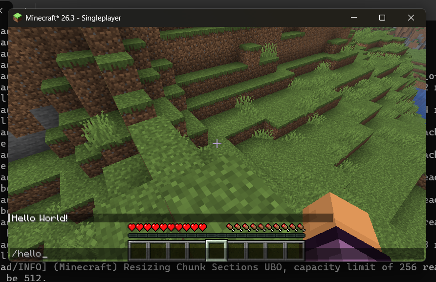
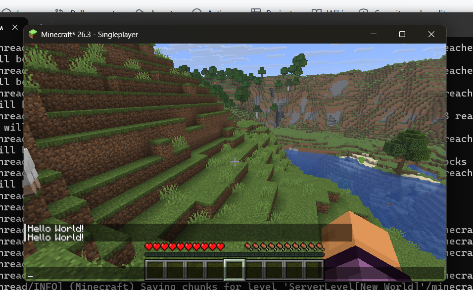

# MineCraft_HelloMod (Minecraft 26.3 Fabric Mod)

A lightweight Fabric mod for **Minecraft 26.3** targeting **Java 25**, implementing a custom chat command `/hello` that returns `"Hello World!"` to the player.

This repository serves as a verified baseline template demonstrating mod lifecycle initialization, Fabric Loom configuration, and Mojang Brigadier command registration under modern Minecraft versions.

---

## 📸 Screenshots & Verification

### 1. Modded Minecraft 26.3 Client Launch
The Fabric Loader successfully loads the mod environment in Minecraft 26.3 with Java 25 runtime.



---

### 2. Executing `/hello` Command
The custom Brigadier command `/hello` is recognized and executed directly from the player chat prompt.



---

### 3. Server/Chat Response
The command source responds back to the sender with formatted `Hello World!` chat feedback.



---

## 🛠️ Tech Stack & Specifications

| Component | Version / Specification |
|---|---|
| **Minecraft** | `26.3` |
| **Java** | `Java 25 (LTS)` |
| **Fabric Loader** | `0.20.1` |
| **Fabric Loom** | `1.19.3` |
| **Fabric API** | `0.165.0+26.3` |
| **Mappings** | Mojang Official Mappings |

---

## 🏗️ Architecture & How It Works

### 1. Mod Manifest (`fabric.mod.json`)
Defines the mod ID (`hellomod`), dependencies (`minecraft ~26.3`, `java >= 25`), and registers the common entrypoint:
```json
"entrypoints": {
  "main": [
    "hellomod.HelloMod"
  ],
  "client": [
    "hellomod.client.HelloModClient"
  ]
}
```

### 2. Mod Lifecycle & Command Registration (`HelloMod.java`)
Implements `ModInitializer`. During the game's startup sequence (`onInitialize()`), the mod hooks into Fabric's `CommandRegistrationCallback` event to attach a node to the Minecraft Brigadier dispatcher:

```java
package hellomod;

import net.fabricmc.api.ModInitializer;
import net.fabricmc.fabric.api.command.v2.CommandRegistrationCallback;
import net.minecraft.commands.Commands;
import net.minecraft.network.chat.Component;
import org.slf4j.Logger;
import org.slf4j.LoggerFactory;

public class HelloMod implements ModInitializer {
    public static final String MOD_ID = "hellomod";
    public static final Logger LOGGER = LoggerFactory.getLogger(MOD_ID);

    @Override
    public void onInitialize() {
        LOGGER.info("Initializing {} for Minecraft 26.3 (Java 25)", MOD_ID);

        // Register the /hello command
        CommandRegistrationCallback.EVENT.register((dispatcher, registryAccess, environment) -> {
            dispatcher.register(
                Commands.literal("hello")
                    .executes(context -> {
                        context.getSource().sendSuccess(
                            () -> Component.literal("Hello World!"),
                            false // false: feedback only sent to executor, not broadcast to ops
                        );
                        return 1;
                    })
            );
        });
    }
}
```

---

## 🚀 Building & Running Locally

### Prerequisites
- **JDK 25** installed and configured on your `PATH`.

### Compile & Build Mod JAR
```bash
# Windows
.\gradlew.bat build

# Linux / macOS
./gradlew build
```
The compiled mod JAR will be output to `build/libs/hellomod-1.0.0.jar`.

### Launch Development Test Client
```bash
# Windows
.\gradlew.bat runClient

# Linux / macOS
./gradlew runClient
```
1. Load or create a singleplayer world.
2. Open chat (`T`) and type `/hello`.
3. Receive the `Hello World!` confirmation response.

---

## 📄 License
This project is licensed under the [CC0-1.0 License](LICENSE).
